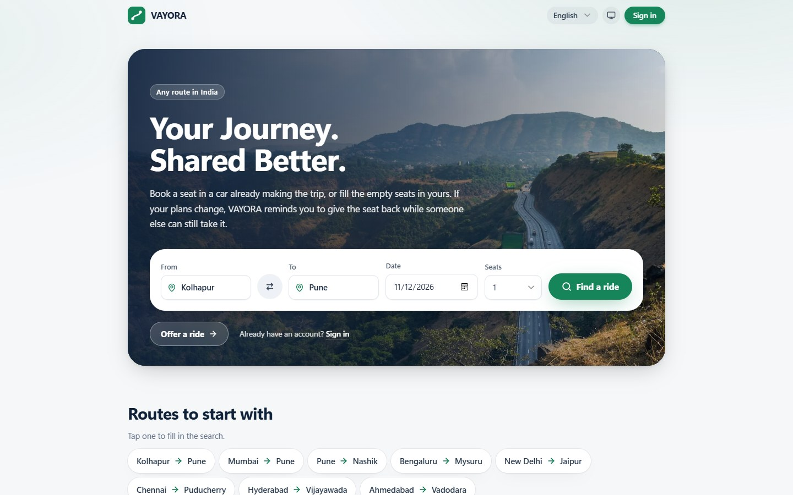
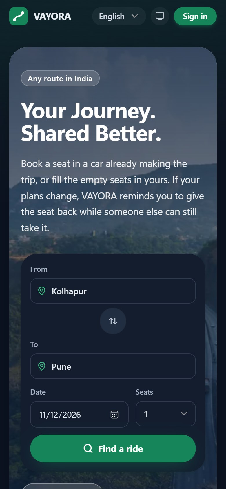
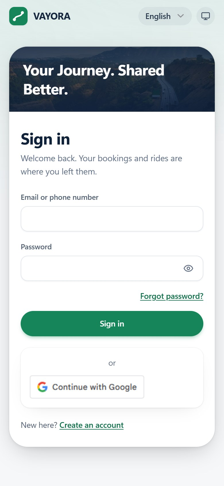
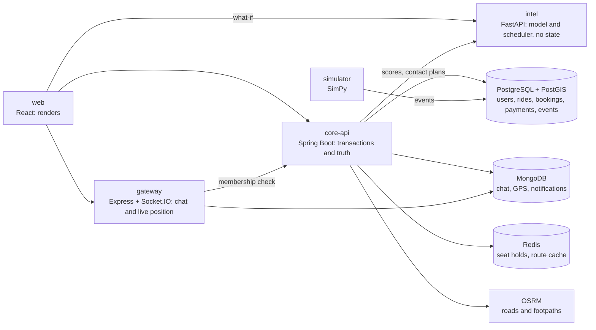

<div align="center">

# VAYORA

**Shared intercity rides in India, built to test one idea about cancellations.**

Final-year B.Tech project · CSE (Data Science) · DYPCET Kolhapur · team of four


[The idea](#the-idea-under-test) · [What we found](#what-the-research-found) · [What it does](#what-the-platform-does) · [Run it](#quick-start) · [Architecture](#architecture) · [Documents](#documents)

<br>



</div>

## The idea under test

> **An early cancellation is a success.** A seat released three days before departure gets refilled
> and the journey completes; the same seat released two hours before departure is destroyed capacity.

VAYORA models how long a booking will last as a survival curve over the seven-day booking horizon,
and acts on it while action still helps. It does so on one corridor, Kolhapur to Pune (~230 km).

The measure is **completed rides per 100 searches**, never bookings: a platform can take more
bookings and still move fewer people.

## At a glance

| | |
|---|---|
| **Features** | 84 verified and 5 partial of the 89 still in scope, the team having removed 6 of the original 95 on 2026-11-02: about 97% counting a partial feature as half. The five need accounts, a native speaker or real data, not more code ([feature matrix](docs/FEATURE_MATRIX.md)) |
| **Routes** | Any route in India in the app, from 126 listed cities or a point on the map. Road distances between Kolhapur and Pune; elsewhere a labelled straight line until a bigger map is built ([how](docs/DEPLOYMENT.md#road-routes-across-india)) |
| **Interface** | A side bar, or tabs on a phone, in light and dark, in the VAYORA brand. Each member starts on a home of their own; screens keep themselves current without a reload |
| **Languages** | English, Hindi and Marathi, on every screen, notification and error message |
| **Tests** | 328 Java, 334 web, 339 Python, 28 gateway, all passing ([what each covers](docs/TESTING.md)) |
| **Research** | On Kolhapur to Pune alone. A SimPy simulator of the corridor: 60 simulated days, 30 seeds per variant, train and validation on disjoint seeds |
| **Data** | All synthetic, plus one public dataset of real hotel cancellations used as a check |

## What the research found

> [!IMPORTANT]
> The answer so far is **no, not in this simulated world**, and the project reports it that way.

<p align="center">
  
</p>

| Variant | What it does | Completed rides per 100 searches |
|---|---|---|
| B0 | Shows rides closest to the passenger's preferred time | 30.22 |
| B3 | Ranks rides by how likely each booking is to last | 30.54 (+0.32) |
| EARLIEST | Shows the soonest-leaving ride first, with no model | 30.54 (+0.32) |
| B4 | As B3, and asks passengers whose booking looks shaky to release it early | 30.56 |
| B5 | As B4, within a contact budget, a CP-SAT scheduler choosing whom to ask | 30.53 |
| ORACLE | Asks exactly the bookings that will cancel late | +0.13 over B3 |

<sub>Current world (h3, with a last-mile effect), 30 paired seeds. Switching that effect off reproduces
the earlier world's committed numbers (B0 30.77, B3 31.11) to every digit.</sub>

- **Asking works on timing but not on rides.** B4 cuts the share of late cancellations by 6.7 points,
  but completed rides do not move measurably (+0.03, 95% interval −0.02 to +0.07). Even if every
  passenger who would cancel released at once and nobody were put off, the gain would be +0.10.
- **Even perfect targeting adds little.** An oracle that knows who will cancel late gains only +0.13,
  because late releases are already refilled 62% of the time against 92% for early ones, and supply,
  not timing, is what runs out: over half of all searches find no ride.
- **The one gain needs no model.** Offering the soonest-leaving ride first does exactly what B3 does
  (−0.001 against B3); a model that knows nothing about the passenger does as well, and the scheduler
  does no better than choosing at random.

<details>
<summary><b>Every experiment since, one finding each</b></summary>

<br>

- **It does not depend on the assumed cancellation rate.** With cancellations three times rarer, where
  the simulated week looks like real hotels', ranking still gains +0.34 and asking still nothing.
- **Tying cancellations to departure changes the picture only a little.** In worlds where most of the
  risk rises as departure nears, not from booking (experiment X1, protocol section 27):
  - the soonest-ride gain keeps 93% of its size, so it is not just shorter exposure;
  - asking starts to help a little, +0.07 (+0.02 to +0.13), against an oracle's +0.25.
- **The ranking gain depends on leaving early costing nothing, though less than predicted.** When
  passengers mind leaving away from their wanted time (experiment X2, protocol section 28), the
  soonest-ride gain shrinks steadily. At 0.03 per hour it is a sixth of its size and no longer
  distinguishable from zero. Shorter exposure explains only about a tenth of it, and survival ranking
  stays equivalent to soonest-first throughout.
- **A ceiling a platform can compute from its own logs holds.** In 41 of 43 settings tried, no
  reconfirmation policy added more standing seats than the paper's first-order ceiling allows
  (experiments X3 and X5, protocol sections 29 and 31). Both exceptions, at the heaviest demand, are
  settings where the ceiling's own assumption fails. Even the oracle reaches only 78% of its ceiling
  in the base world.
- **Moved one at a time, the supply, demand and cancellation rate assumed change none of this**
  (experiment X5): reconfirmation's effect stays within ±0.10 of zero in all nine settings tried, and
  survival ranking keeps its gain at 6, 12 and 20 rides a day.
- **Moved together, they make asking cost rides more often than not** (experiment X7, protocol
  section 32). Across 20 settings that also vary how passengers respond to being asked, B4's whole 95%
  interval lies below B3's in 13 and above it in one. In five it is not within ±0.10, at worst −0.28.
  An oracle never gains more than +0.18.
- **On real hotel cancellations, features do help.** The same kinds of model rank who cancels better
  than lead time alone (concordance 0.597 for Cox and 0.653 for gradient boosting, against 0.544),
  which suggests the simulated world understates what booking features can tell. At every lead time,
  not just the final week, they reach 0.715 to 0.742 (experiment X4, protocol section 30).

</details>

Every number above is a SQL query over the event log. The method is in
[AI_ML_METHODOLOGY](docs/AI_ML_METHODOLOGY.md), every run and its intervals in
[EXPERIMENT_PROTOCOL](docs/EXPERIMENT_PROTOCOL.md), and the seven report figures in
[docs/figures](docs/figures/README.md).

## What the platform does

<p align="center">
  
  &nbsp;&nbsp;&nbsp;
  
</p>

**Passengers**
- Search by town or by exact points on a map, and see for each ride the walk to the pickup on real
  footpaths, an auto-rickshaw estimate with the published meter fare where one exists, the driver's
  record of rides kept, and a match score for both sides.
- Hold seats for five minutes while deciding, book or request, choose what happens if the driver
  withdraws (this ride only, or rebook automatically), and be picked up off the stops where the driver
  allows a detour.
- Chat with the driver, follow the driver's live position, call through a masked number, show a
  boarding code, confirm the trip happened, rate it, and keep receipts in their own language.
- Pay the driver directly after the ride, in cash or by UPI: VAYORA charges nothing.

**Drivers**
- Add vehicles (electric ones with their range, which publishing respects) and publish rides with
  intermediate stops, per-stretch prices from the road route, a return trip and weekly repeats.
- Set how far they will go out of their way, accept or decline requests, start the ride, check
  boarding codes, mark no-shows and complete.
- See earnings and their own reliability record. They put a UPI ID or QR code on their account, keep
  the whole fare, and mark each passenger paid.
- Are told when passengers searched a stretch they drive and found nothing.

**Every member**
- A profile with photo and preferences, an email or phone confirmed by code, emergency contacts, and
  an emergency button that puts **112** first.
- Reset a forgotten password with a code, sign out so the session ends at once, download what VAYORA
  keeps about them, and delete their account.
- A seat-release reminder 48 hours before boarding asks, without any penalty, whether plans have
  changed.

**Administrators**
- A back office: reports and moderation, the emergency queue, members, rides and bookings, disputed
  trips, bus alternatives, rest stops and chargers, unmet demand, and the audit log.
- The durability model's scores with the reason behind each, and a what-if page that runs the
  simulator live at a setting no saved sweep covered.

> [!NOTE]
> The model never cancels, prices or refuses anyone: the only thing it decides is whom the
> seat-release reminder asks. What is simulated, mocked or missing is listed plainly in
> [KNOWN_LIMITATIONS](docs/KNOWN_LIMITATIONS.md).

## Architecture



| Part | Built with | Owns |
|---|---|---|
| `web` | Vite, React 18, TypeScript, Tailwind | Rendering |
| `core-api` | Spring Boot 3, Java 21, Flyway | Every transaction and every fact |
| `intel` | FastAPI, Python 3.11 | Inference: the survival model and the contact scheduler; holds no state |
| `gateway` | Express 4, Socket.IO 4 | Live streams only: ride chat and the driver's position |
| `mobile` | Expo, React Native, TypeScript | The Android app for passengers and drivers; talks to core-api and the gateway like the web app |
| `sim`, `experiments` | SimPy, lifelines, scikit-survival, OR-Tools | The research: simulator, model training, variants and sweeps |

No entity lives in two stores. Why each thing lives where it does is in
[ARCHITECTURE](docs/ARCHITECTURE.md).

## Quick start

Requires Docker with Compose v2. Nothing else needs to be installed.

**On Windows**, double-click **`run.bat`**. It starts Docker Desktop if needed, builds and starts every
service, and lists their addresses and the administrator. It then offers to add demo rides and
members, and opens the app. **`stop.bat`** stops everything and keeps the data.

**Anywhere else**, from the repository's folder:

```sh
docker compose up -d --build --wait
sh infra/check-health.sh
```

Then open **http://localhost:5173** and create an account as a passenger or a driver. The first run
downloads a ~220 MB OpenStreetMap extract and builds the road and footpath graphs; later runs reuse
the volume and start in seconds. `docker compose down` stops everything and keeps the data; adding
`-v` would delete it.

| Service | Role | Address |
|---|---|---|
| web | React app | http://localhost:5173 |
| core-api | Spring Boot 3, Java 21 | http://localhost:8080/actuator/health |
| intel | FastAPI, Python 3.11 | http://localhost:8000/health |
| gateway | Express 4 + Socket.IO 4 | http://localhost:3000/health |

Backing services: PostgreSQL 16 + PostGIS 3.4 (`5432`), MongoDB 7 (`27017`), Redis 7 (`6379`),
OSRM (`5000`).

**An administrator** cannot sign up. Copy `.env.example` to `.env` (or add to the `.env` you have), set
`ADMIN_EMAIL` and `ADMIN_PASSWORD` (12 characters or more), and run `docker compose up -d core-api`.

**The API** is described at http://localhost:8080/swagger-ui.html: every endpoint, with its fields,
tried from the page once **Authorize** has the token sign-in returns.

<details>
<summary><b>Demo data</b>, to see the platform with rides in it</summary>

<br>

`run.bat` offers it. By hand (needs Node 20):

```sh
DEMO_PASSWORD=<8 or more characters> node scripts/demo-data.mjs
```

Four drivers, six days of corridor rides each way, and two passengers with seats booked, all signing in
with that password, then a past to look at: trips completed and rated, earnings, a no-show,
cancellations, a request waiting and documents waiting for staff. Set `DEMO_ADMIN_EMAIL` and
`DEMO_ADMIN_PASSWORD` too and it marks some document checks, noted as demo, and runs the real durability
model over the bookings. Every account, review and ride note says it is made up, and nothing it does
reaches the research figures, which are computed per simulation run. It makes the app look used; it is
not evidence of anything. It refuses any API but this machine's.

</details>

<details>
<summary><b>A port already in use?</b></summary>

<br>

Every host port is a `*_PORT` setting in `.env` (for example `MONGO_PORT=27018` when another
MongoDB has 27017), and `check-health.sh` reads the same variables:

```sh
cp .env.example .env
set -a; . ./.env; set +a; sh infra/check-health.sh
```

</details>

## Putting it online

One command on a server with a domain name: `sh scripts/deploy.sh`. It adds HTTPS, closes every port
but 80 and 443, and refuses to start without real secrets. See
[DEPLOYMENT](docs/DEPLOYMENT.md#putting-vayora-online). It has been tried on one machine with a local
certificate, not yet on a real server.

## Real services, off until you switch them on

Out of the box nothing leaves the platform: VAYORA moves no money, since passengers pay their driver
directly, codes and messages go to a simulated outbox an administrator can read, and calls are
simulated. Each real service below turns on when its settings are in `.env`, except email, whose
settings also go in core-api's `environment` in `docker-compose.yml`. Each is tested against a stand-in;
only Google has been tried against the real service.

| Service | What it switches on | Settings |
|---|---|---|
| Google | "Sign in with Google" | `GOOGLE_CLIENT_ID` |
| Twilio | Codes, notification copies and emergency texts by SMS; masked calls bridged through the platform's number | `TWILIO_ACCOUNT_SID`, `TWILIO_AUTH_TOKEN`, `TWILIO_FROM` |
| Any SMTP server | Codes and notification copies by email | `SPRING_MAIL_HOST`, `SPRING_MAIL_PORT`, `SPRING_MAIL_USERNAME`, `SPRING_MAIL_PASSWORD`, `VAYORA_MAIL_FROM` |
| Web Push | Push notifications in the browser | `VAYORA_PUSH_PUBLIC_KEY`, `VAYORA_PUSH_PRIVATE_KEY` (`node scripts/vapid-keys.mjs` makes a pair) |

`.env` is never committed. Step-by-step setup for each is in
[DEPLOYMENT](docs/DEPLOYMENT.md#switching-on-real-services), with every setting and what breaks.

## Tests

```sh
docker compose --profile test run --rm core-api-tests      # core-api: Java 21, real PostGIS, MongoDB and Redis
docker compose --profile research run --rm research        # event log, simulator, model, scheduler, experiments, intel
(cd web && npm ci && npm test)                             # React screens, translations, money and dates
(cd gateway && npm ci && npm test)                         # real Socket.IO server and clients
```

The Python suite needs PostgreSQL running (`docker compose up -d --wait postgres core-api`) and works in
a throwaway schema. Two tests keep the languages honest: one fails if the app shows text that is not
translated, the other if the server can send a message the app cannot translate.

## On a phone

The **Android app** in [`mobile/`](mobile/README.md) gives passengers and drivers VAYORA on a phone, in
all three languages: search, book, boarding codes, chat and the driver's position for passengers;
vehicles, publishing, requests and the trip for drivers. It runs on any Android phone through the
free Expo Go app, from this computer, or as an APK built in Expo's cloud. Administrators, profiles
and the assistant stay on the website.

```sh
cd mobile && npm ci && npx expo start     # then scan the QR code with Expo Go on the same Wi-Fi
```

## Reproducing the research

```sh
scripts/reproduce.sh               # tests, model, ladder and sweeps, about an hour
scripts/reproduce.sh --no-sweeps   # tests, model and ladder only
```

It rebuilds the main results (the variant ladder, the robustness runs, the hotel comparison and the
earlier sweeps) from the configuration in `experiments/configs/`, and fails unless each one comes out
exactly as committed. The first run downloads the public hotel bookings and checks their SHA-256. The
soonest-first ladder and experiments X1 to X7 are not in it yet; the protocol gives each one's
commands.

Single steps:

```sh
# Train and evaluate the durability model
docker compose --profile research run --rm research python -m experiments.hazard.train

# Run one variant on the 30 experiment seeds
docker compose --profile research run --rm research python -m sim.run --variant experiments/configs/variants/B4.yaml
```

Every threshold, budget and assumed value lives in `experiments/configs/*.yaml`, none in code. Latent
passenger types drive behaviour in the simulator and are never model features.

## The event log

Every number in the report is a SQL aggregate over one table, `events`, through
[`experiments/analysis/metrics.sql`](experiments/analysis/metrics.sql). Two writers share it and a fixed
vocabulary of 24 event types: core-api's `EventLogService`, which never throws into its caller, and the
Python `vayora_events` writer, which fails loudly. The platform and the simulator speak the same
vocabulary; the platform's own rows sit outside every simulation run.

## Documents

| Document | What it answers |
|---|---|
| [ARCHITECTURE](docs/ARCHITECTURE.md) | What the parts are and why things live where they do |
| [DATABASE_DESIGN](docs/DATABASE_DESIGN.md) | Every table, collection and key |
| [API_DOCUMENTATION](docs/API_DOCUMENTATION.md) | Every endpoint and who may call it |
| [SECURITY](docs/SECURITY.md) | What is protected, how it is checked, and what is missing |
| [DEPLOYMENT](docs/DEPLOYMENT.md) | Running it, configuring it, and what breaks |
| [FEATURE_MATRIX](docs/FEATURE_MATRIX.md) | The state of each of the 95 features, and the evidence for it |
| [TESTING](docs/TESTING.md) | What is tested, and what is not |
| [KNOWN_LIMITATIONS](docs/KNOWN_LIMITATIONS.md) | Everything that does not work, is simulated, or could be mistaken for more |
| [AI_ML_METHODOLOGY](docs/AI_ML_METHODOLOGY.md) | The survival models, their explanations and the contact scheduler |
| [EXPERIMENT_PROTOCOL](docs/EXPERIMENT_PROTOCOL.md) | How variants are compared, and every result with its interval |
| [Figures](docs/figures/README.md) | The report's seven figures, with captions |
| [DATASET_DOCUMENTATION](docs/DATASET_DOCUMENTATION.md) | Where every dataset comes from |
| [DECISIONS](docs/DECISIONS.md) | Every design decision, why, and what it costs |
| [IMPLEMENTATION_ROADMAP](docs/IMPLEMENTATION_ROADMAP.md) | What is left and what it needs |
| [PROGRESS](docs/PROGRESS.md) | What was built when |

The binding project rules (frozen parameters, the architecture rule, research integrity) are in
[CLAUDE.md](CLAUDE.md).

<details>
<summary><b>Repository layout</b></summary>

<br>

| Path | What |
|---|---|
| `web/` | Vite + React 18 + TypeScript + Tailwind |
| `mobile/` | Expo + React Native + TypeScript: the Android app ([how to run it](mobile/README.md)) |
| `core-api/` | Spring Boot 3, Java 21, `com.dypcet.vayora`, Flyway migrations |
| `intel/` | FastAPI, Python 3.11: durability model, explanations, contact scheduler, live what-if, assistant |
| `gateway/` | Express 4 + Socket.IO 4, JWT verification |
| `sim/` | SimPy simulator of the corridor |
| `vayora_events/` | Python event-log writer and the event vocabulary |
| `experiments/` | Configs (every tunable number), runners, analysis queries and committed reports |
| `infra/` | OSRM corridor preparation, the online setup's edge server, stack health check |
| `scripts/` | `reproduce.sh`, demo data, deployment, backups, push key generation |
| `docs/` | Report material, figures and screenshots |

OSRM serves a clipped bounding box: `infra/osrm/prepare.sh` downloads Geofabrik's western India extract
and clips it to the corridor (`OSRM_BBOX`, default `73.4,16.4,74.9,18.9`). A route outside that box
shows as a straight line and says so. To rebuild from scratch:
`docker compose down && docker volume rm vayora_osrmdata`.

</details>

## Data and credits

- Map data © [OpenStreetMap](https://www.openstreetmap.org/copyright) contributors (ODbL), routed with
  OSRM.
- Noto Sans, for names in nine Indian scripts on PDF receipts: © The Noto Project Authors, SIL Open Font
  License 1.1 (`core-api/src/main/resources/fonts/OFL.txt`).
- The photo of the Khandala ghat on the front page and in the screenshots: Sonika Agarwal, on Unsplash.
- Hotel bookings: Nuno Antonio, Ana de Almeida and Luis Nunes (2019), *Hotel booking demand datasets*,
  Data in Brief 22, 41–49, [doi:10.1016/j.dib.2018.11.126](https://doi.org/10.1016/j.dib.2018.11.126),
  CC BY 4.0.
- Everything else is synthetic, generated by the simulator under the assumptions in
  `experiments/configs/world.yaml`. Nothing here is evidence about real passengers.
